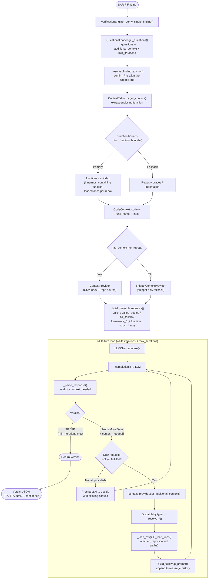
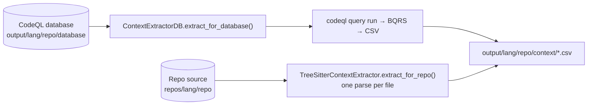

# Context Extraction in the Verification Process

This document describes how source-code context is extracted and supplied to the
LLM during the verification stage of the VulnHunterX pipeline. Code locations are
given as `module` + symbol rather than line numbers, which drift.

## Context Extraction Flow

The policy evidence-closure path calls the typed entry point
`ContextProvider.resolve_evidence()` instead. It runs the same `_resolve_*`
handlers but returns `EvidenceResult` objects with status, scope,
exhaustiveness and provenance. `get_additional_context()` is the string
adapter over those same handlers.

## How the context CSVs are produced (Stage 3, upstream)

`prepare` extracts context after database creation (unless `--skip-context` is
set) and picks a backend per repo. With `--backend auto` (the default), CodeQL is
used where a database exists and tree-sitter covers the rest. Existing CSVs are
kept unless `--force` is given, so re-run with `--force` to pick up new producers
such as `typedefs`/`enums`.

| CSV | CodeQL (`config/queries/tools/<lang>`) | tree-sitter |
|---|---|---|
| `functions`, `callers` | all supported languages | all supported languages |
| `classes` | python, javascript (incl. TS), php, java, go | python, javascript (incl. TS), php, java, go, csharp |
| `structs`, `globals`, `macros` | c, cpp | c, cpp |
| `typedefs`, `enums` | c, cpp | — |
| `free_sites`, `destructors`, `field_writes` | c, cpp | — |

`struct:` requests read `structs.csv` for c/cpp and `classes.csv` for every other
language (`evidence.struct_csv_name()`).

Notes on the tree-sitter backend:

- A call inside an anonymous callback is attributed to the nearest named
  enclosing function. An anonymous function bound to a name
  (`const h = () => …`, `obj.m = function () {…}`) is indexed under that name.
- `callee_file` is set only when the callee name has exactly one defining file.
  With homonyms it stays empty, so file-qualified caller lookups fail closed
  instead of binding to the wrong definition.
- `node_modules/` and `.git/` are not indexed.
- TypeScript repos are indexed under `javascript`, as CodeQL does. `.ts`,
  `.mts` and `.cts` are parsed with the `typescript` grammar and `.tsx` with
  `tsx` (from `tree-sitter-typescript`). Classes, abstract classes and
  interfaces go into `classes.csv`, so DTO types resolve via `struct:`.

## Key points

- **Two-phase context model.** Some context is **pre-fetched** up front. This
  covers requests keyed off the enclosing function name (`caller`,
  `callee_bodies`, `all_callers`) and repo-wide framework greps. Placeholder
  names such as `<unknown>` are never looked up. All other context is
  **reactive**: it is fetched only when the LLM asks for it via `context_needed`
  in a `Needs More Data` verdict.

- **Two providers.** `ContextProvider` resolves requests against the CSV index
  and the repo source. If the repo has no context directory, the engine falls
  back to `SnippetContextProvider`, which scans the snippet with regexes and
  returns an `<unavailable: out-of-snippet>` sentinel when the data is outside
  that scope.

- **Absence is not proof.** A symbol-index miss is `INCOMPLETE_INDEX`, never
  `NOT_FOUND_COMPLETE`. Only the bounded framework greps can report complete
  absence. When a symbol has several definitions (`#ifdef` variants, the same
  class name in two modules), up to three are shown and the result is
  `AMBIGUOUS`, not `FOUND`.

- **The multi-turn loop** (`LLMClient.analyze()`) deduplicates requests against
  context already fulfilled, holds back early TP/FP verdicts until
  `min_iterations` is reached, and can force a decision turn if the LLM stalls
  on `Needs More Data`.

## Supported request types

| Request | Source | Languages |
|---|---|---|
| `caller:f`, `all_callers:f` | `callers.csv` (+ JS/TS route bindings) | all |
| `callees:f`, `callee_bodies:f` | `callers.csv` + `functions.csv` | all |
| `function:f` (`method:`, `func:`) | `functions.csv` | all |
| `struct:T` (`class:`) | `structs.csv` / `classes.csv` | all |
| `global:v`, `macro:M`, `typedef:T`, `enum:E` | matching CSV | c, cpp |
| `free_sites:p`, `destructor:T`, `field_writes:T.f` | CodeQL-only CSVs | c, cpp |
| `framework_sanitizers:*`, `framework_guards:*` | bounded repo grep | JS/TS |

## Reference: components and entry points

| Component | Module | Entry points |
|---|---|---|
| Enclosing-function slice | `context/extractor.py` | `ContextExtractor.get_context()`, `_find_function_bounds()` |
| CodeQL extraction | `codeql/context_extractor.py` | `ContextExtractorDB.extract_for_database()`, `QUERIES_BY_LANG` |
| tree-sitter extraction | `context/treesitter_extractor.py` | `TreeSitterContextExtractor.extract_for_repo()`, `FUNC_NODE_TYPES` |
| CSV provider | `context/provider.py` | `get_additional_context()`, `resolve_evidence()` |
| Evidence model | `context/evidence.py` | `EvidenceRequest`, `EvidenceResult`, `inspect_capability()` |
| Snippet fallback | `context/snippet_provider.py` | `SnippetContextProvider` |
| Engine | `verification/engine.py` | `_verify_single_finding()`, `_build_prefetch_requests()` |
| LLM client | `llm/client.py` | `analyze()`, `_parse_response()` |
| Prompts | `llm/prompts.py` | `build_user_prompt()`, `build_followup_prompt()` |
